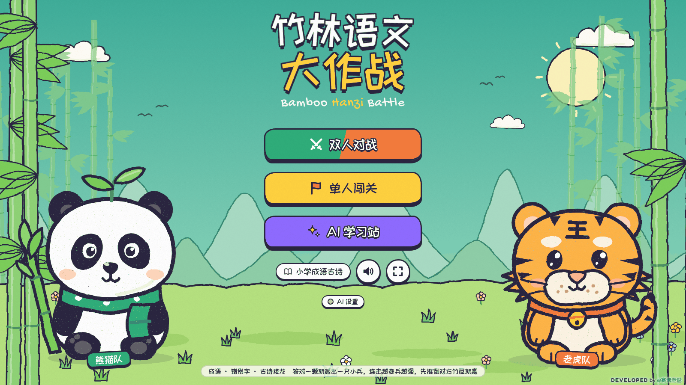
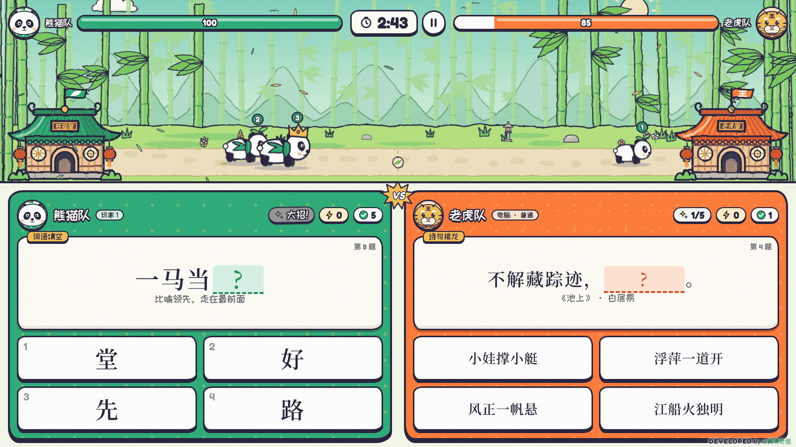
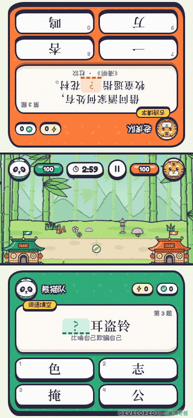
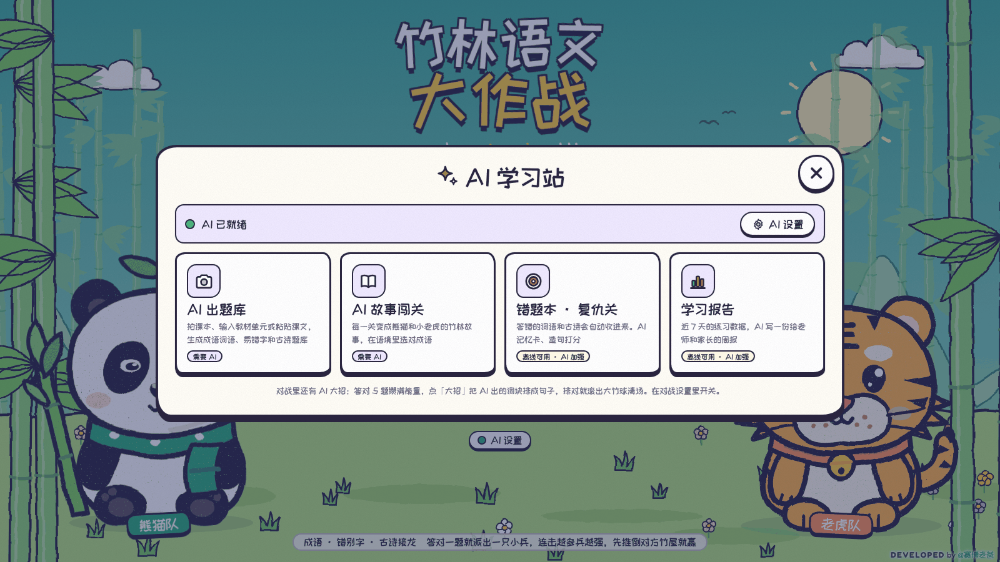
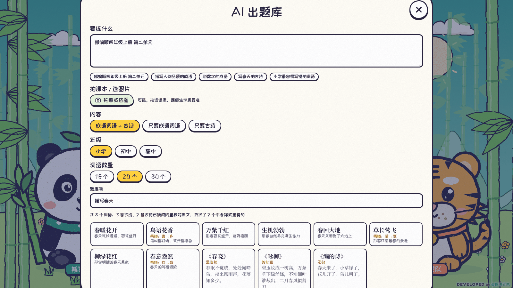
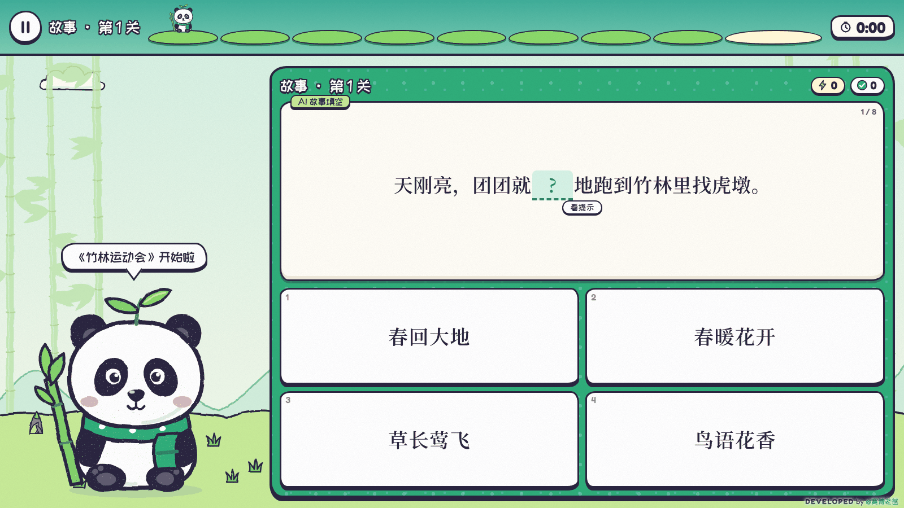
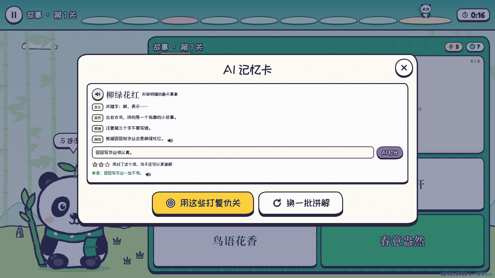
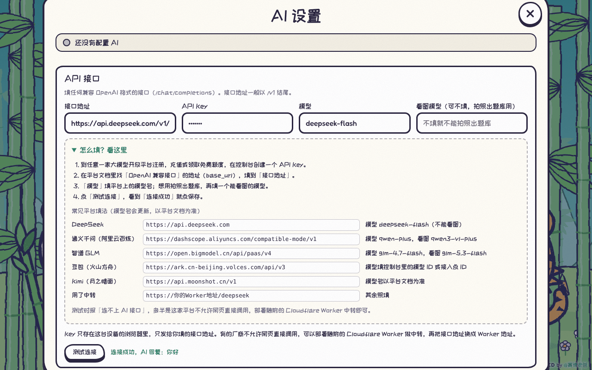

# Chinese Study Game · 竹林语文大作战

> DEVELOPED by **@赛博老爸** · Bamboo Hanzi Battle

一款面向中文词语、成语和古诗练习的浏览器学习游戏，适合家庭练习、同伴对战和课堂互动。核心玩法无需账号或 API Key；AI 是可选增强功能。

**[软件说明](docs/SOFTWARE.md) · [使用指南](docs/USER_GUIDE.md) · [下载完整项目](https://github.com/cyberdaddyleo/Chinese-study-game/archive/refs/heads/main.zip)**

熊猫队 vs 老虎队的语文对战小游戏。答对一题，就从自家竹屋派出一只小兵冲向对面；连击越多兵越强，先推倒对方竹屋的一方获胜。题目覆盖成语释义、错别字辨析、成语接龙、古诗接龙和古诗填字。

- 手绘卡通画风，熊猫、小老虎、竹屋、竹林、荷塘全部由代码实时绘制，没有图片素材
- 双人同屏对战 / 人机对战 / 12 关单人闯关
- 支持触屏，教室一体机大屏、平板、手机都能玩；手机竖屏时两人面对面各点一边
- 一个 HTML 文件，不用安装、不用构建，双击打开就能玩
- 填上自己的大模型 API 后，解锁 AI 出题库、AI 故事闯关、AI 记忆卡、AI 大招、AI 学习周报



| 双人对战 | 手机竖屏：面对面对战 |
| --- | --- |
|  |  |

---

## 目录

- [快速开始](#快速开始)
- [玩法](#玩法)
- [AI 功能](#ai-功能)
- [配置 AI 接口](#配置-ai-接口)
- [AI 接口中转（可选）](#ai-接口中转可选)
- [题库](#题库)
- [技术说明](#技术说明)
- [项目结构](#项目结构)
- [隐私与数据保存](#隐私与数据保存)
- [作者](#作者)
- [许可](#许可)

---

## 快速开始

**本地直接玩**：点击上方「下载完整项目」，解压后双击根目录的 `index.html`，用浏览器打开即可。也可在 GitHub 文件页下载单独的 `index.html`。无需安装依赖、启动后端或配置 AI。

第一次使用：先选「题库」，再进入「双人对战」或「单人闯关」。完整步骤见 [使用指南](docs/USER_GUIDE.md)。

**部署到 GitHub Pages**：

1. 把整个仓库推到 GitHub
2. 仓库 `Settings → Pages`，Source 选 `Deploy from a branch`，分支选 `main`，目录选 `/ (root)`
3. 等一两分钟，访问 `https://cyberdaddyleo.github.io/Chinese-study-game/`

**部署到 Cloudflare Pages**：新建 Pages 项目 → 连接这个仓库 → 构建命令留空，输出目录填 `/` → 部署。

> AI 功能会从网页直接请求大模型接口，建议部署后通过 `https://` 访问（GitHub Pages、Cloudflare Pages 或任意静态服务器）。直接双击打开本地文件时，游戏本体照常能玩，部分平台的接口可能会拒绝本地文件发起的请求。

---

## 玩法

### 双人对战

- 两队各答各的题，**同一题号两边题型相同、题目不同**，公平又抄不了对面
- 答对：派出一只小兵。连对 3 题派出戴围巾的大号兵（战力 2），连对 6 题派出戴皇冠的兵（战力 3）
- 两边小兵相撞会互相抵消战力，剩下的继续前进；冲到对方竹屋造成「战力 × 5」点伤害
- 答错：答题板被竹叶缠住约 2 秒，同时显示正确答案（乱点会吃亏）
- 竹屋 100 血，先推倒对方获胜；时间到（2 / 3 / 5 分钟可选）比剩余血量
- 对手可选「好友同屏」或「电脑」（简单 / 普通 / 困难）
- 题型档位：
  - 轻松：看意思选词语、词语填空、诗句接龙
  - 标准：再加选出正确写法、古诗填字
  - 全能：再加找出错别字、成语接龙、拼出词语、诗句出处

### 单人闯关（荷塘闯关）

- 每个题库 12 关，每关 10 题（按当前题库安排词语和古诗），过关解锁下一关
- 正确率 60% 过关，80% 两星，90% 且在目标时间内三星
- 关卡越往后，题型越难：从释义、填字，到正确写法、找错别字、成语接龙、拼词语
- 设备有中文语音时，还会出现「听音选词」；答完会朗读词语或诗句
- 结算页列出答错的内容，点一下听朗读

### 题型

| 题型 | 说明 |
| --- | --- |
| 看意思选词语 | 看释义，四选一 |
| 词语填空 | 词语挖掉一个字，从易混字里选对的（优先挖课本里最容易写错的那个字） |
| 选出正确写法 | 四种写法里只有一种是对的，其余是常见错别字 |
| 找出错别字 | 词语里有一个错字，点出来；答完显示正确的字 |
| 成语接龙 | 用上一个成语的最后一个字开头，选出能接上的成语 |
| 拼出词语 | 看释义，按顺序点字拼出词语（有干扰字） |
| 诗句接龙 | 给出上句，选出下句 |
| 古诗填字 | 古诗里挖掉一个字，选出原字 |
| 诗句出处 | 给出两句诗，选出出自哪首诗 |
| 听音选词 | 朗读词语，选出听到的那个（闯关模式，需要设备有中文语音） |

### 键盘（可选）

- 对战：熊猫队 `1` `2` `3` `4`，老虎队 `7` `8` `9` `0`，`Esc` 暂停
- 闯关：`1` `2` `3` `4` 选答案，`Esc` 暂停

---

## AI 功能

首页点「AI 学习站」进入。带「需要 AI」标记的功能要先在「AI 设置」里填好接口。

| 功能 | 说明 | 需要 AI |
| --- | --- | --- |
| AI 出题库 | 输入教材单元（如「部编版四年级上册 第二单元」）、一个主题（如「描写春天的成语」「送别诗」），或粘贴课文；也可以拍课本。可选只要成语词语、只要古诗或两者都要。程序会校验每一项（易错写法必须和原词只差一个字、去重、去掉不合格的），和内置古诗同名的会自动换成校对过的原文，预览后保存成题库 | 是 |
| AI 故事闯关 | 当前题库至少有 4 个词语时，关卡提供「AI 故事版」（纯古诗题库不支持）：把本关的成语词语编进熊猫团团和小老虎虎墩的竹林故事，在句子里选对成语；可点「看提示」看释义；结束后可看全文、朗读全文。故事保存在本地，重玩不重复消耗 | 是 |
| 错题本 · 复仇关 | 答错的词语和古诗自动收进错题本，同一个连续答对 2 次自动移出；复仇关只考这些内容，题型随机换 | 否 |
| AI 记忆卡 · 造句打分 | 词语卡：字义拆解、来历典故、易错提醒、例句；古诗卡：白话意思、一句话赏析、背诵窍门。还可以自己用这个词造句，AI 打 0–3 星并给出修改句 | 是 |
| AI 大招（对战） | 当前题库至少有 4 个词语时可用。答对 5 题攒满能量，点「大招」把 AI 切好的词块排成通顺的句子；排对就滚出大竹球，压扁对面所有小兵并砸竹屋 15 点。电脑对手也会放大招。可在对战设置里关闭 | 是 |
| 学习报告 | 近 7 天的局数、答题数、正确率、每日答题量，以及累计各题型正确率、近 7 天最常错的词语和古诗；AI 写一份老师和家长都能直接用的周报，一键复制 | 数据不需要，周报需要 |



| AI 出题库 | AI 故事闯关 |
| --- | --- |
|  |  |



> 截图里的 AI 内容是示例，实际内容由你配置的模型生成。AI 按教材单元名出题时凭记忆整理，可能和课本有出入；AI 给出的古诗原文请对照课本核对。

---

## 配置 AI 接口

首页点「AI 设置」，填四项：

| 字段 | 说明 |
| --- | --- |
| 接口地址 | OpenAI 兼容接口的 base_url，一般以 `/v1` 结尾。程序会自动拼上 `/chat/completions` |
| API Key | 在平台控制台创建 |
| 模型 | 平台上的模型名 |
| 看图模型 | 可不填。填了才能「拍照出题库」 |

填好点「测试连接」，看到「连接成功」再点保存。

**接口地址示例**（与项目内置中转路由对应；地址及模型可用性以平台当前文档和控制台为准）：

| 平台 | 接口地址 | 模型填写 |
| --- | --- | --- |
| DeepSeek | `https://api.deepseek.com` | 填写控制台当前可用的文本模型名 |
| 通义千问（阿里云百炼） | `https://dashscope.aliyuncs.com/compatible-mode/v1` | 文本模型与看图模型分别填写控制台提供的名称 |
| 智谱 GLM | `https://open.bigmodel.cn/api/paas/v4` | 填写控制台当前可用的模型名；拍照功能需支持图像输入 |
| 豆包（火山方舟） | `https://ark.cn-beijing.volces.com/api/v3` | 控制台里的模型 ID 或接入点 ID |
| Kimi（月之暗面） | `https://api.moonshot.cn/v1` | 以平台文档为准 |

**接口要求**：

- 请求格式：`POST {接口地址}/chat/completions`，`Authorization: Bearer <Key>`，OpenAI Chat Completions 格式
- 看图：图片以 `image_url`（base64 data URL）传入，需要模型支持
- 模型需要能按要求输出 JSON（程序会容错解析代码块里的 JSON，并对内容做校验）



---

## AI 接口中转（可选）

有些平台不允许网页直接调用接口（浏览器跨域被拦），测试时会提示「连不上 AI 接口」。这时部署 `worker/ai-proxy-worker.js` 到 Cloudflare Workers 做中转：

1. 登录 Cloudflare → `Workers & Pages` → `Create` → 创建一个 Worker
2. 把 `worker/ai-proxy-worker.js` 的内容粘贴进去，部署
3. Worker 的 `Settings → Variables` 里加一个变量：`ALLOW_ORIGIN = https://你的游戏域名`（限制正常浏览器的跨站请求；此变量不是身份鉴权）
4. 游戏「AI 设置」里，接口地址改成 `https://<你的worker域名>/<平台名>`，其余照填

| 平台名 | 转发到 |
| --- | --- |
| `deepseek` | `https://api.deepseek.com` |
| `qwen` | `https://dashscope.aliyuncs.com/compatible-mode/v1` |
| `zhipu` | `https://open.bigmodel.cn/api/paas/v4` |
| `ark` | `https://ark.cn-beijing.volces.com/api/v3` |
| `moonshot` | `https://api.moonshot.cn/v1` |

例：`https://bamboo-ai.xxx.workers.dev/deepseek`

此 Worker 脚本未实现 Key 持久化，会把请求中的 Key 和相关内容转发给对应平台。浏览器到 Worker、Worker 到平台均会经过相应服务；`ALLOW_ORIGIN` 不能替代服务端鉴权。要加别的平台，在脚本顶部的 `TARGETS` 里加一行即可。

---

## 题库

内置三套：

| 题库 | 内容 |
| --- | --- |
| 小学成语古诗 | 63 个小学常用成语（含易错写法）+ 35 首小学必背古诗 |
| 初中成语古诗 | 53 个初中常考成语（含大量易错写法和可接龙的成语）+ 15 首初中必背古诗 |
| 易错字专练 | 46 个最容易写错的成语和词语，每个都带典型错误写法 |

**自己的题库**：「题库 → 我的题库」，每行一条，**总条目至少 6，且词语至少 6 个或古诗至少 3 首**。例如 6 个词语、6 首古诗、3 个词语加 3 首古诗均可；只有 3 首诗还不够。下面是可直接粘贴的完整示例：

```
迫不及待 急迫得不能再等待 ×迫不急待
一丝不苟 形容做事认真，一点也不马虎
画龙点睛 比喻在关键处加上一笔，使内容更加生动
守株待兔 比喻不主动努力，心存侥幸，希望得到意外收获
刻舟求剑 比喻拘泥成法，不懂得根据情况的变化处理问题
亡羊补牢 比喻出了问题以后想办法补救，可以防止继续受损失
《春晓》孟浩然 春眠不觉晓，处处闻啼鸟。夜来风雨声，花落知多少。
```

- 词语：`词语 释义`；想练错别字，在后面加 `×错误写法`（只能错一个字）
- 古诗：`《题目》作者 全文`，用中文逗号、句号分句
- 词语和古诗可以混在一起写

**修改内置题库**：在 `index.html` 里搜索 `var BANKS`。词语每项一行，格式为 `词语|释义|错误写法（可省）`；古诗格式为 `题目|作者|全文`。易混字表在 `var CONFUSE`，填空题和错别字题的干扰字优先从这里取。

---

## 技术说明

- **单文件**：HTML + CSS + 原生 JavaScript，没有框架、没有依赖、没有构建步骤
- **画面**：熊猫、小老虎、竹屋、竹林、荷塘全部是代码生成的 SVG，用 SVG 滤镜（feTurbulence + feDisplacementMap）做出手绘抖动和蜡笔颗粒；对战场地用 Canvas 绘制小兵、飘落的竹叶和特效
- **声音**：Web Audio 实时合成音效；朗读用浏览器自带的中文语音合成（speechSynthesis，zh-CN）
- **字体**：界面用 ZCOOL KuaiLe、Fredoka、Gochi Hand；题目用系统楷体（KaiTi / STKaiti），没有楷体时用 Noto Serif SC，方便看清每一笔。网络字体来自 Google Fonts（均为 OFL 开源授权），访问不了时自动回退系统字体，游戏照常运行
- **存储**：进度、题库、错题本、学习记录、AI 设置都存在浏览器 `localStorage`（键名 `bamboo-hanzi-battle-v1`）；存储被禁用时自动退回内存，不影响游玩
- **兼容**：近几年的 Chrome、Edge、Safari、Firefox；教室一体机建议 Chromium 内核 88 以上
- **多点触控**：答题按钮用 `pointerdown` 响应，两个人同时点互不干扰

`index.html` 里的代码分块：

| 模块 | 作用 |
| --- | --- |
| `BANKS` / `CONFUSE` / `parseCustom` | 内置题库、易混字表、自定义题库解析 |
| `ART` | 熊猫、小老虎、小兵、竹屋的 SVG 绘制和手绘滤镜 |
| `SCENE` | 首页竹林、对战场地、荷塘地图的背景 |
| `SND` | 音效合成与中文朗读 |
| `AI` | 大模型接口调用、提示词、结果校验 |
| 主逻辑 | 出题、答题板、对战引擎、闯关、AI 功能界面 |

---

## 项目结构

```
Chinese-study-game/
├── index.html                 # 游戏本体（单文件）
├── worker/
│   └── ai-proxy-worker.js     # 可选：AI 接口中转（Cloudflare Worker）
├── docs/
│   ├── SOFTWARE.md            # 软件说明
│   ├── USER_GUIDE.md          # 使用指南
│   └── screenshots/           # README 截图
├── README.md
└── LICENSE
```

---

## 隐私与数据保存

- 游戏没有自建账号系统或学习数据后端；学习记录、进度、题库和 AI 设置默认保存在当前浏览器的 `localStorage` 中。
- 更换设备、浏览器或访问地址不会自动同步数据；清除浏览器站点数据会清除这些本地记录。存储被禁用时仅在内存中保留，关闭页面后可能丢失。
- 使用 AI 功能时，相关词语、课文、句子、照片或学习统计会发送到配置的 AI 接口，API Key 会作为请求认证信息一同发送；使用中转时还会经过相应 Worker / Cloudflare 服务。
- API Key 保存在当前浏览器中，不随本仓库分发。共享设备使用后可在「AI 设置」清空 Key 并保存。
- 页面会请求 Google Fonts 加载字体；字体不可用时会回退系统字体。离线可使用核心游戏，AI 功能需要网络与可用接口。

---

## 作者

DEVELOPED by **@赛博老爸**

## 许可

[MIT](LICENSE)
