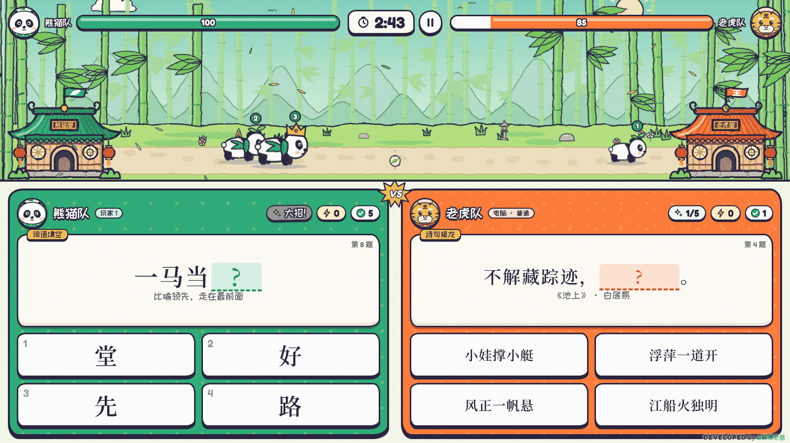
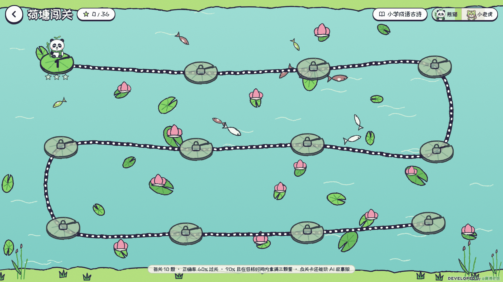
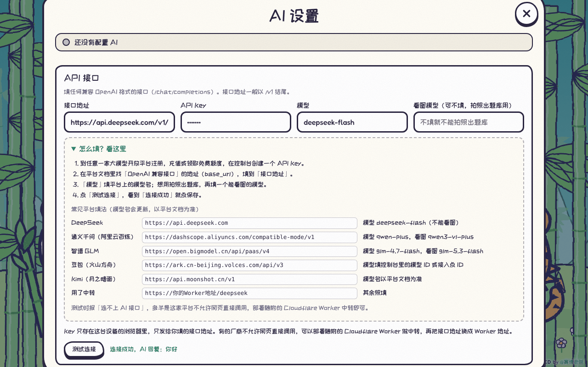

# 使用指南 · 竹林语文大作战

## 1. 下载并打开

1. 进入 [Chinese-study-game 仓库](https://github.com/cyberdaddyleo/Chinese-study-game)，点击 **Code → Download ZIP**，或直接 [下载项目 ZIP](https://github.com/cyberdaddyleo/Chinese-study-game/archive/refs/heads/main.zip)。
2. 解压文件，找到根目录 `index.html`。
3. 双击，用浏览器打开。首页出现熊猫与小老虎后即可开始，不需要注册账号或填写 AI 接口。

首次使用建议先用内置题库完成一局，再按需要配置 AI。手机或平板更适合通过已部署的网站访问；本地文件的打开方式取决于设备。


## 2. 选择题库

首页点击「题库」，选择「小学成语古诗」「初中成语古诗」或「易错字专练」。题库决定对战和闯关使用的学习内容；切换题库后可查看对应闯关进度。

## 3. 开始对战

1. 点击首页「双人对战」。
2. 在「对战设置」选择「好友同屏」或电脑难度。
3. 选择 2 / 3 / 5 分钟，以及「轻松」「标准」「全能」题型档位。
4. 点击「开战！」，按画面提示准备，倒计时结束后作答。
5. 两队点击各自答题区；拼词题按顺序点字。没有配置 AI 时，游戏会正常进行，AI 大招不可用。

答对派出小兵；连续答对 3 题和 6 题会派出更强的小兵。答错会短暂锁住答题区并显示正确答案。竹屋初始 100 血，先推倒对方获胜；时间到比较剩余血量。

电脑快捷键：熊猫队 `1` `2` `3` `4`，老虎队 `7` `8` `9` `0`，`Esc` 暂停。触屏可以两人同时点击；手机竖屏可面对面各用一侧。



## 4. 单人闯关

1. 点击首页「单人闯关」，进入荷塘地图。
2. 选择已解锁的关卡，点击「开始闯关」。每关 10 题，共 12 关。
3. 按题目要求点击答案，或使用 `1`—`4` 快捷键；`Esc` 暂停。
4. 正确率达到 60% 过关，80% 两星，90% 且达到目标用时可获三星。过关后解锁下一关。
5. 在结算页复习答错的内容；设备支持中文语音时可点击听朗读。

词语和古诗题目来自当前题库；纯词语题库不会凭空增加古诗内容。听音题和朗读是否可用取决于设备中文语音。



## 5. 使用自己的题库

进入「题库」，在「我的题库」文本框内每行填写一条，再点「保存并使用我的题库」。

- 词语格式：`词语 释义`。
- 练习错别字：在后面加 `×错误写法`，错误写法应与正确词语只差一个字。
- 古诗格式：`《题目》作者 全文`，用中文标点分句。
- **按当前代码的校验规则，总条目至少 6，且满足「至少 6 个词语」或「至少 3 首古诗」。** 例如 6 个词语、6 首古诗、3 词＋3 诗都可保存；只放 3 首诗不够。

下面 6 条词语可以直接复制：

```text
迫不及待 急迫得不能再等待 ×迫不急待
一丝不苟 形容做事认真，一点也不马虎
画龙点睛 比喻在关键处加上一笔，使内容更加生动
守株待兔 比喻不主动努力，心存侥幸，希望得到意外收获
刻舟求剑 比喻拘泥成法，不懂得根据情况的变化处理问题
亡羊补牢 比喻出了问题以后想办法补救，可以防止继续受损失
```

## 6. 配置可选 AI 功能

1. 首页点击「AI 设置」。
2. 从所选服务商文档和控制台获取 **OpenAI 兼容接口地址、API Key、模型名**，分别填写。
3. 若要拍照出题，另填支持图像输入的「看图模型」；不需要时可留空。
4. 点击「测试连接」，出现「连接成功」后点击「保存」。
5. 返回首页，进入「AI 学习站」选择功能。

接口地址应填基础地址，程序会拼接 `/chat/completions`。项目内的模型示例可能随平台更新，实际填写以服务商控制台为准。AI 调用可能产生服务商费用。



| 入口 | 操作 |
| --- | --- |
| AI 出题库 | 输入教材单元、主题或课文，选择内容类型；也可上传课本图片。生成后核对预览，再保存题库 |
| AI 故事版 | 在关卡详情中点击「AI 故事版」。题库至少需要 4 个词语；纯古诗题库不显示此入口 |
| 错题本 · 复仇关 | 查看错题并进行定向复习，不要求 AI 接口 |
| AI 记忆卡 | 查看词语或古诗的讲解；词语可继续练习造句并获取评分 |
| AI 大招 | 当前题库至少有 4 个词语，对战设置开启后，答对 5 题攒满能量，点击「大招」完成词块排序 |
| 学习报告 | 查看近 7 天数据及累计题型统计；配置 AI 后可生成并复制学习周报 |

AI 教材题库并非官方教材数据库。生成内容、诗句原文与解释请对照课本检查。截图中的 AI 内容为示例。

## 7. 保存记录与共享设备

进度、题库、错题、学习记录及 AI 设置保存在当前浏览器。它们不会自动同步到其他手机或电脑；清除浏览器站点数据会清除记录。使用无痕模式或禁用存储时，记录可能无法长期保留。

AI 请求会把相关内容及 API Key 发送到所配置接口；如果使用 Worker，中转服务也会收到请求。共享设备使用后，可在「AI 设置」清空 API Key 并保存。

## 8. 常见问题

| 问题 | 处理方法 |
| --- | --- |
| 不填 AI 能玩吗？ | 可以，内置题库、对战、普通闯关、错题复习及数据统计可直接使用 |
| 下载后看到代码或网页列表 | 确认已解压，用浏览器打开 `index.html`，而不是直接在 GitHub 文件页阅读源码 |
| 没有声音或朗读 | 检查游戏声音开关和设备音量，先点击一次页面；中文朗读还依赖设备语音支持 |
| 自定义题库保存失败 | 检查格式、有效条目数，以及上面的总条目和词语 / 古诗门槛 |
| 测试连接失败 | 检查地址、Key、模型名和网络；服务商若限制浏览器跨域请求，可使用随附 Worker |
| 能聊天但不能拍照出题 | 单独填写支持图像输入的看图模型，并核对平台支持的接口格式 |
| 换设备后进度不见了 | 记录保存在原浏览器；当前版本不提供云端自动同步 |

## 9. 部署为在线游戏

在自己的 GitHub 仓库中进入 **Settings → Pages**，选择 **Deploy from a branch**，分支 `main`、目录 `/ (root)`，保存后等待部署。此仓库按该方式部署时，预期地址为 `https://cyberdaddyleo.github.io/Chinese-study-game/`；只有部署成功后该地址才能访问。

也可将整个项目交给静态网站托管服务，无需构建。AI 接口跨域中转的部署方法见 [README：AI 接口中转](../README.md#ai-接口中转可选)。`ALLOW_ORIGIN` 用于限制浏览器来源，不是完整身份鉴权。
